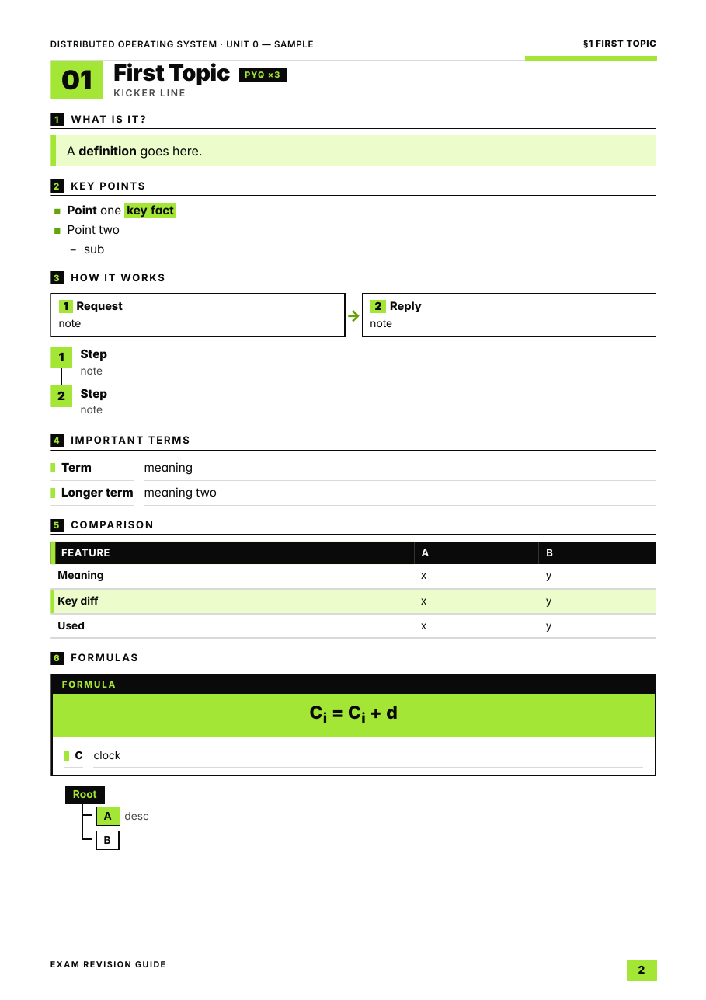

# exam-revision-guide-kit

Turn lecture slides into **print-ready exam revision guides**: multi-page A4 PDFs in a clean black / white / lime design. Each guide has a cover with a contents list and a concept map, one section per topic, exam-trap boxes, formula cards, quick-check questions, and a one-page **30-Second Revision** sheet at the end.

It's built with plain HTML + CSS and printed to PDF by headless Chrome. The text is real, selectable and searchable, diagrams are vector, and fonts are embedded.



See [`sample.pdf`](sample.pdf) for the built demo: cover, content pages and the 30-Second Revision page.

## What's inside

| File | Purpose |
|---|---|
| `guide.css` | The design system: palette, typography, A4 page rules, running headers and footers, all components |
| `build.py` | Two-pass build. Renders the PDF, fills in the contents page numbers, sets per-section page markers, and checks that the 30-second page is the single last page and that fonts are embedded |
| `preview.sh` | Renders every page as a PNG plus a contact sheet for visual QA |
| `sample.html` | Minimal skeleton showing every component. Copy it to start a unit |
| `LEARNINGS.md` | Full playbook: workflow, design decisions, component reference, pitfalls and fixes, and a brief for an AI agent per unit |
| `AGENTS.md` / `CLAUDE.md` | Instructions picked up automatically by Codex / Claude Code (see below) |

## Requirements

- Google Chrome or Chromium, version 131 or newer (needed for `@page` margin boxes and named pages)
- Python 3
- poppler-utils (`pdftotext`, `pdftoppm`, `pdffonts`)
- ImageMagick (`montage`, used only by `preview.sh`)
- The [Inter](https://rsms.me/inter/) font installed system-wide

If Chrome isn't on your PATH as `google-chrome`, point to it:
```bash
export CHROME="/Applications/Google Chrome.app/Contents/MacOS/Google Chrome"   # macOS
export CHROME=chromium                                                          # Linux alt
```

## Quick start

```bash
git clone https://github.com/soham901/exam-revision-guide-kit && cd exam-revision-guide-kit
python3 build.py sample.html sample.pdf      # rebuilds the demo guide
./preview.sh sample.pdf                      # sample-p-*.png + sample-sheet.png
```

## Making a guide for your subject

1. Extract your slides to text: `pdftotext -layout unit1.pdf src/unit1.txt`. For slides that are mostly images, render them with `pdftoppm` and read them visually.
2. `cp sample.html unit1.html`, then edit the first line, which is the running header:
   ```html
   <!-- HDR: SUBJECT NAME · UNIT 1 — UNIT TITLE -->
   ```
3. Write one `<section class="sec" id="sN" data-title="Topic">` per topic, using the components (see the table in `LEARNINGS.md`). End with `<section class="rev30" id="rev30">`.
4. Contents page numbers fill in automatically from `<span class="pg" data-sec="sN"></span>`.
5. Build, preview, fix, repeat.

## Using it with Claude Code or Codex

The repo is set up for coding agents. `AGENTS.md` holds the agent instructions: workflow, hard rules and the QA checklist. Codex reads `AGENTS.md` automatically. Claude Code reads `CLAUDE.md`, which simply imports `AGENTS.md`. Neither tool needs any extra setup.

**1. Set up a folder per subject:**

```bash
git clone https://github.com/soham901/exam-revision-guide-kit my-subject-guides
cd my-subject-guides
mkdir sources && cp ~/Downloads/unit*.pdf ~/Downloads/question-bank.pdf sources/
```

`.gitignore` already keeps PDFs, extracted text and `unit*.html` out of git, so your course material won't be committed by accident.

**2. Start the agent in that folder:**

```bash
claude      # Claude Code
codex       # OpenAI Codex CLI
```

**3. Give it a prompt like this:**

```text
Build exam revision guides following AGENTS.md.
Subject: Computer Networks. Units: all PDFs in sources/unit*.pdf (one guide per unit).
A4 portrait, as long as needed. Use sources/question-bank.pdf only for QB/PYQ badges.
Output PDFs to out/. Check every page visually before you finish.
```

The agent will:
1. extract the slides;
2. write `unitN.html` files;
3. build them with `build.py`;
4. check every page image with `preview.sh` and fix any layout problems;
5. tell you which items it marked `SOURCE UNCLEAR`.

**Tips:**
- **Several units:** Claude Code can run one subagent per unit in parallel. Ask for it ("use one subagent per unit"). In Codex, run one session per unit, or do the units one after another.
- **Your own detailed spec:** paste a long spec (sections, design, what to emphasise) into the prompt along with "follow AGENTS.md". `AGENTS.md` covers the defaults; your prompt overrides the details.
- **The core rule is facts only from your sources.** If the agent fills a gap from general knowledge, tell it to mark the gap `SOURCE UNCLEAR` instead.
- **Restyling:** to change the colours or fonts for every unit, ask the agent to edit `guide.css` once, before any units are built. Don't let it restyle units one by one.

## Design rules

- Only black, white and lime (`#A3E635`). Light grey is allowed only for table rows and hairlines.
- Lime is never used for small text on white. Text on lime is always black.
- Body text is 10pt or larger; tables and compact text never go below 9pt.
- Every section starts on a new page, and boxes, tables and traps never split across pages.

## License

MIT. Fork it, restyle it, use it for any subject.
